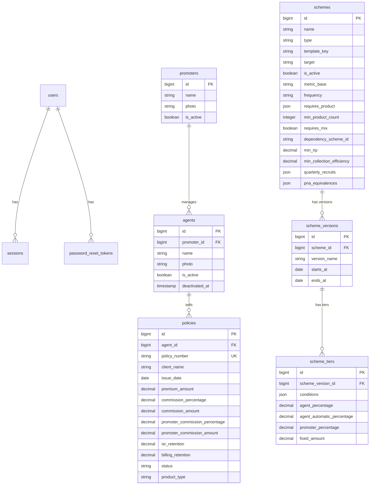

# 01 — Database Schema

## Overview

The database currently consists of **10 tables** across **3 domains**. The project is designed to scale to ~100 tables as modules are added.

All tables use Laravel conventions: auto-incrementing `id` as primary key, `created_at`/`updated_at` timestamps, foreign keys with snake_case naming (`agent_id` referencing `agents.id`).

---

## Domain 1: Core / Authentication

### `users`
System administrators/operators who log into the application.

| Column | Type | Notes |
|--------|------|-------|
| `id` | BIGINT (PK) | Auto-increment |
| `name` | VARCHAR(255) | User display name |
| `email` | VARCHAR(255) | Unique, used for login |
| `email_verified_at` | TIMESTAMP | Nullable |
| `password` | VARCHAR(255) | Hashed (bcrypt) |
| `remember_token` | VARCHAR(100) | For "remember me" |
| `created_at` | TIMESTAMP | |
| `updated_at` | TIMESTAMP | |

**Relationships:** None. Users are independent of the promoter/agent hierarchy.

---

### `password_reset_tokens`
Password reset flow tokens.

| Column | Type | Notes |
|--------|------|-------|
| `email` | VARCHAR(255) PK | |
| `token` | VARCHAR(255) | Hashed reset token |
| `created_at` | TIMESTAMP | Nullable |

---

### `sessions`
Laravel session storage (file-based by default; DB-backed if configured).

| Column | Type | Notes |
|--------|------|-------|
| `id` | VARCHAR(255) PK | Session ID |
| `user_id` | BIGINT FK → `users.id` | Nullable, indexed |
| `ip_address` | VARCHAR(45) | Nullable |
| `user_agent` | TEXT | Nullable |
| `payload` | LONGTEXT | Serialized session data |
| `last_activity` | INTEGER | Unix timestamp, indexed |

---

### `jobs` (and `job_batches`, `failed_jobs`)
Laravel queue system tables. Standard Laravel structure. Used for async processing (configured with database queue driver).

---

### `cache` (and `cache_locks`)
Laravel cache system tables. Standard structure.

---

## Domain 2: Sales Force Organization

### `promoters` (promotores)
Sales team leaders. Each promoter manages multiple agents.

| Column | Type | Notes |
|--------|------|-------|
| `id` | BIGINT (PK) | Auto-increment |
| `name` | VARCHAR(255) | Promoter full name |
| `photo` | VARCHAR(255) | Nullable, path in `storage/app/public/photos/` |
| `is_active` | BOOLEAN | Default `true`. For soft-deactivation without delete. |
| `created_at` | TIMESTAMP | |
| `updated_at` | TIMESTAMP | |

**Relationships:**
- `hasMany` → `agents` (Agent::class)

---

### `agents` (agentes)
Individual sales agents. Each belongs to one promoter.

| Column | Type | Notes |
|--------|------|-------|
| `id` | BIGINT (PK) | Auto-increment |
| `promoter_id` | BIGINT FK → `promoters.id` | Nullable, `ON DELETE SET NULL` |
| `name` | VARCHAR(255) | Agent full name |
| `photo` | VARCHAR(255) | Nullable, path in `storage/app/public/photos/` |
| `is_active` | BOOLEAN | Default `true` |
| `deactivated_at` | TIMESTAMP | Nullable. Set when agent is deactivated. Used by `activeInPeriod` scope. |
| `created_at` | TIMESTAMP | |
| `updated_at` | TIMESTAMP | |

**Relationships:**
- `belongsTo` → `promoters` (Promoter::class)
- `hasMany` → `policies` (Policy::class)

**Key Scope:** `activeInPeriod($periodEnd)` — An inactive agent appears in results ONLY for months up to and including their `deactivated_at` month. After that, they're excluded. This is critical for bonus calculations where an agent who left mid-quarter should still count for that quarter.

---

## Domain 3: Insurance Operations

### `policies` (pólizas)
Insurance policies sold by agents. This is the transactional heart of the system.

| Column | Type | Notes |
|--------|------|-------|
| `id` | BIGINT (PK) | Auto-increment |
| `agent_id` | BIGINT FK → `agents.id` | `ON DELETE CASCADE` |
| `policy_number` | VARCHAR(255) | Unique. External insurance company policy number. |
| `client_name` | VARCHAR(255) | Nullable. Name of the insured client. |
| `issue_date` | DATE | Date policy was issued |
| `premium_amount` | DECIMAL(12,2) | Total premium (prima) amount in MXN |
| `commission_percentage` | DECIMAL(5,2) | Agent commission percentage. Default 0. |
| `commission_amount` | DECIMAL(12,2) | Agent commission amount (calculated). Default 0. |
| `promoter_commission_percentage` | DECIMAL(5,2) | Promoter override commission %. Default 0. |
| `promoter_commission_amount` | DECIMAL(12,2) | Promoter override commission amount. Default 0. |
| `isr_retention` | DECIMAL(5,2) | ISR (tax) retention percentage. Default 10%. |
| `billing_retention` | DECIMAL(5,2) | Billing/factoring cost percentage. Default 5%. |
| `status` | VARCHAR(255) | One of: `Activa`, `No tomada`, `Pagada`. Default `Activa`. |
| `product_type` | VARCHAR(255) | Nullable. Product: `METLIFE`, `PERFECTLIFE`, `PRIMORDIAL`. |
| `created_at` | TIMESTAMP | |
| `updated_at` | TIMESTAMP | |

**Relationships:**
- `belongsTo` → `agents` (Agent::class)

**Status Workflow:**
```
Activa ──→ No tomada (policy wasn't accepted by client)
Activa ──→ Pagada   (policy premium was fully paid)
```

Status colors for UI: Activa = green, No tomada = gray, Pagada = blue.

**Key Methods on Model:**
- `netAmount()` — Calculates net income: `premium_amount` minus commission costs (ISR + billing deducted).
- `changeStatus($newStatus)` — Validated status transition.
- `activate()`, `markAsNoTomada()`, `markAsPaid()` — Convenience methods.

---

## Domain 4: Compensation Configuration

### `schemes` (esquemas)
Flexible configuration for commissions AND bonuses. A "scheme" is a set of rules that determine how people get paid.

| Column | Type | Notes |
|--------|------|-------|
| `id` | BIGINT (PK) | Auto-increment |
| `name` | VARCHAR(255) | Human-readable name (e.g., "Bono de Verano 2026") |
| `type` | VARCHAR(255) | Either `commission` or `bonus` |
| `template_key` | VARCHAR(255) | Nullable. Machine identifier for bonus type (e.g., `connection`, `first_year_production`). Used by `BonusCalculatorFactory`. |
| `target` | VARCHAR(255) | `promoter`, `agent`, or `both` |
| `is_active` | BOOLEAN | Default `true`. Only ONE commission can be active at a time. Multiple bonuses can be active. |

**Global Rules (apply to all tiers within the scheme):**

| Column | Type | Notes |
|--------|------|-------|
| `metric_base` | VARCHAR(255) | Nullable. `PCA`, `PP`, or `PNA` — the metric used for calculation. |
| `frequency` | VARCHAR(255) | Nullable. `única`, `mensual`, `trimestral`, `anual` — how often the bonus is paid. |
| `requires_anticipos` | BOOLEAN | Default `false`. Whether advances are required. |
| `anticipos_config` | JSON | Nullable. Configuration for advance payments. |
| `applies_annual_adjustment` | BOOLEAN | Default `false`. Whether annual adjustment applies. |
| `requires_product` | JSON | Nullable. Array of product types required (e.g., `["PRIMORDIAL"]`). |
| `min_product_count` | INTEGER | Default 0. Minimum policies of the required product. |
| `requires_mix` | BOOLEAN | Default `false`. Whether product diversification is required. |
| `dependency_scheme_id` | VARCHAR(255) | Nullable. References another scheme's `template_key`. This scheme only unlocks if the prerequisite scheme was achieved. |
| `min_irp` | DECIMAL(5,2) | Default 0. Minimum IRP percentage. |
| `min_collection_efficiency` | DECIMAL(5,2) | Default 0. Minimum collection efficiency %. |
| `quarterly_recruits` | JSON | Nullable. Quarterly recruitment quotas (e.g., `{"q1":3,"q2":4}`). |
| `pna_equivalences` | JSON | Nullable. PNA weighting table for Activity Ratio (see below). |
| `created_at` | TIMESTAMP | |
| `updated_at` | TIMESTAMP | |

**Relationships:**
- `hasMany` → `scheme_versions` (SchemeVersion::class)
- `hasManyThrough` → `scheme_tiers` via `scheme_versions`

**PNA Equivalences Structure (for Activity Ratio):**
```json
[
  {"min_pna": 16000, "max_pna": 20999, "policies": 0.5},
  {"min_pna": 21000, "max_pna": 59999, "policies": 1.0},
  {"min_pna": 60000, "max_pna": 119999, "policies": 1.5},
  {"min_pna": 120000, "max_pna": null, "policies": 2.0}
]
```
Policies with PNA < $16,000 are ignored for weighted counting.

---

### `scheme_versions` (versiones de esquema)
Each scheme can have multiple versions with effective dates. This enables time-based rule changes without losing history.

| Column | Type | Notes |
|--------|------|-------|
| `id` | BIGINT (PK) | Auto-increment |
| `scheme_id` | BIGINT FK → `schemes.id` | `ON DELETE CASCADE` |
| `version_name` | VARCHAR(255) | Label (e.g., "Q1 2026") |
| `starts_at` | DATE | Version effective start date |
| `ends_at` | DATE | Nullable. Version effective end date. Null means still active. |
| `created_at` | TIMESTAMP | |
| `updated_at` | TIMESTAMP | |

**Relationships:**
- `belongsTo` → `schemes` (Scheme::class)
- `hasMany` → `scheme_tiers` (SchemeTier::class)

---

### `scheme_tiers` (bandas / rangos)
Tiers are conditional brackets within a scheme version. When evaluating compensation, the system checks each tier's conditions to determine which bracket the person falls into.

| Column | Type | Notes |
|--------|------|-------|
| `id` | BIGINT (PK) | Auto-increment |
| `scheme_version_id` | BIGINT FK → `scheme_versions.id` | `ON DELETE CASCADE` |
| `conditions` | JSON | Flexible conditions object (see below) |
| `agent_percentage` | DECIMAL(5,2) | Default 0. Agent's percentage if this tier is met. |
| `agent_automatic_percentage` | DECIMAL(5,2) | Default 0. Guaranteed bonus percentage for agent (bono garantizado). |
| `promoter_percentage` | DECIMAL(5,2) | Default 0. Promoter's percentage if this tier is met. |
| `fixed_amount` | DECIMAL(12,2) | Nullable. Fixed dollar amount alternative to percentage. |
| `created_at` | TIMESTAMP | |
| `updated_at` | TIMESTAMP | |

**Relationships:**
- `belongsTo` → `scheme_versions` (SchemeVersion::class, via `scheme_version_id`)

**Conditions JSON varies by scheme type:**

| Calculator | Typical Conditions | Example |
|------------|-------------------|---------|
| Agent First Year Production | `min_pca` | `{"min_pca": 50000}` |
| Promoter First Year Production | `min_pp`, `min_irp`, `max_irp` | `{"min_pp": 200000, "min_irp": 91, "max_irp": null}` |
| Connection Bonus | `min_recruits`, `max_recruits`, `min_pca` | `{"min_recruits": 3, "max_recruits": 4, "min_pca": 30000}` |
| Monthly Development | `min_pca`, `min_month`, `max_month` | `{"min_pca": 15000, "min_month": 0, "max_month": 12}` |
| Activity Ratio | `classification`, `min_policies`, `max_policies` | `{"classification": "Plata", "min_policies": 2.0, "max_policies": 2.99}` |
| Additional Agents | `min_agents`, `max_agents` | `{"min_agents": 3, "max_agents": 5}` |
| Commission (product) | `product_type` | `{"product_type": "METLIFE"}` |

---

## Entity Relationship Diagram



---

## Migration History (Chronological)

| Migration File | What It Does |
|---------------|-------------|
| `0001_01_01_000000` | Creates `users`, `password_reset_tokens`, `sessions` |
| `0001_01_01_000001` | Creates `cache`, `cache_locks` |
| `0001_01_01_000002` | Creates `jobs`, `job_batches`, `failed_jobs` |
| `2026_05_20_193959` | Creates `promoters` (name only initially) |
| `2026_05_20_194051` | Creates `agents` (name + promoter_id FK) |
| `2026_05_20_194148` | Creates `policies` with all financial columns |
| `2026_05_20_194213` | Creates `schemes` with all global rule columns |
| `2026_05_20_194220` | Creates `scheme_versions` |
| `2026_05_20_194233` | Creates `scheme_tiers` |
| `2026_05_28_000001` | Adds `scheme_type`, `scheme_id` to `policies` |
| `2026_05_28_000002` | **Removes** above + adds `product_type`, `promoter_commission_*` to `policies` |
| `2026_05_28_000003` | Adds `client_name` to `policies` |
| `2026_05_29_000001` | Adds `photo` and `is_active` to both `promoters` and `agents` |
| `2026_05_30_000001` | Adds `agent_automatic_percentage` to `scheme_tiers` |
| `2026_05_30_000002` | Adds `template_key` to `schemes` |
| `2026_05_31_000001` | Adds `deactivated_at` to `agents` |

> **Note:** Migration `2026_05_28_000002` reversed the approach of linking policies to schemes. The current model computes commissions dynamically from the active commission scheme rather than storing the scheme reference on each policy.

### Source: Key Policy Migration (`2026_05_20_194148_create_policies_table.php`)

```php
Schema::create('policies', function (Blueprint $table) {
    $table->id();
    $table->foreignId('agent_id')->constrained('agents')->onDelete('cascade');
    $table->string('policy_number')->unique();
    $table->date('issue_date');
    $table->decimal('premium_amount', 12, 2);
    $table->decimal('commission_percentage', 5, 2)->default(0);
    $table->decimal('commission_amount', 12, 2)->default(0);
    $table->decimal('isr_retention', 5, 2)->default(10.00);
    $table->decimal('billing_retention', 5, 2)->default(5.00);
    $table->string('status')->default('activa');
    $table->timestamps();
});
```

> **Precision notes:** `premium_amount` and `commission_amount` use `DECIMAL(12,2)` — max 10 integer digits + 2 decimal. `commission_percentage`, `isr_retention`, `billing_retention` use `DECIMAL(5,2)` — max 3 integer digits + 2 decimal (values 0.00–999.99%). The later migration `2026_05_28_000002` added `product_type`, `promoter_commission_percentage`, and `promoter_commission_amount` columns and removed `scheme_type`/`scheme_id`.
