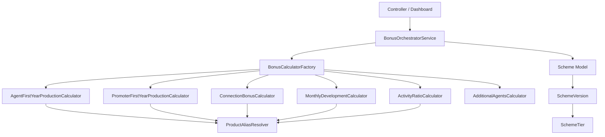

# 07 — Module: Bonus Calculation Engine

## Business Purpose
The core compensation calculation system. Evaluates whether a promoter or agent has met the conditions for any active bonus scheme and computes the payout amount. Uses the **Strategy Pattern** to isolate each bonus type's unique calculation logic while sharing common infrastructure through the **Orchestrator Pattern**.

## Architecture



---

## Key Files

| File | Role |
|------|------|
| `app/Services/BonusOrchestratorService.php` | Central orchestrator — loads schemes, resolves dependencies, dispatches to calculators |
| `app/Services/BonusCalculators/BonusCalculatorInterface.php` | Strategy interface that all calculators implement |
| `app/Services/BonusCalculators/BonusCalculatorFactory.php` | Maps `template_key` → calculator class |
| `app/Services/BonusCalculators/ProductAliasResolver.php` | Trait: resolves product aliases (e.g., "Vida" → METLIFE + PERFECTLIFE) |
| `app/Services/BonusCalculators/AgentFirstYearProductionCalculator.php` | Agent first-year PCA bonus |
| `app/Services/BonusCalculators/PromoterFirstYearProductionCalculator.php` | Promoter first-year PP + IRP bonus |
| `app/Services/BonusCalculators/ConnectionBonusCalculator.php` | Connection bonus (recruit PCA matrix) |
| `app/Services/BonusCalculators/MonthlyDevelopmentCalculator.php` | Monthly development bonus (agent PCA × tenure) |
| `app/Services/BonusCalculators/ActivityRatioCalculator.php` | Activity ratio (weighted policies) |
| `app/Services/BonusCalculators/AdditionalAgentsCalculator.php` | Additional agents bonus |
| `app/Services/CommissionService.php` | Legacy commission calculator (partially deprecated) |

---

## BonusOrchestratorService — Orchestrator

### `calculateAll()` Flow
```
1. Load active bonus schemes filtered by target (agent/promoter)
2. Topological sort by dependencies (dependency_scheme_id)
3. For each scheme in order:
   a. Resolve effective period (monthly → month, trimestral → quarter, etc.)
   b. Check if dependency scheme was achieved (skip if not)
   c. Use BonusCalculatorFactory to get the right Strategy
   d. Execute calculator with effective period
   e. If dependency not achieved, force is_achieved = false but still show progress
4. Consolidate summary (total achieved, total amount)
```

### `calculateOne()` Flow
Same as above but for a single scheme by `template_key`. Useful for preview endpoints.

### `toFrontendFormat()`
Transforms the raw calculation result into a frontend-friendly format with:
- `name`, `unlocked` (boolean), `progress` (0-100), `target`, `conditions[]`

### Period Expansion
The orchestrator "expands" the period based on scheme frequency:
- `mensual` → start to end of the month containing `periodEnd`
- `trimestral` → start to end of the quarter containing `periodEnd`
- `anual` → start to end of the year containing `periodEnd`
- `única` → uses the period as-is

This is separate from the "visual range" — what the user selected in the UI.

---

## Dependency Resolution

Schemes can declare `dependency_scheme_id` (references another scheme's `template_key`). The orchestrator:
1. Builds a dependency graph.
2. Evaluates schemes in topological order (dependencies first).
3. If a prerequisite bonus was NOT achieved, the dependent bonus fails — but its progress bars still show so the user can see what they're missing.
4. A dependency bar is prepended to the `progress_breakdown` with `_isDependency: true`.

---

## Calculator Details

### 1. AgentFirstYearProductionCalculator
**Template Keys:** `agent_first_year_production`, `Producción 1er Año Vida Trimestral (3 meses)`

**Rules:**
- Only applies to agents in their first year (`created_at + 1 year ≥ periodEnd`).
- Validates product requirements via `validateGlobalRules()` which supports two formats:
  - **New format** (since 2026-07-15): `[{product_type: "PRIMORDIAL", min_count: 3}]` — each product has its own minimum count. ALL must be met (AND logic).
  - **Legacy format**: `["PRIMORDIAL"]` + `min_product_count` column — maintained for backward compat.
- Uses `ProductAliasResolver` to resolve "Vida" → METLIFE + PERFECTLIFE when counting policies.
- Calculates PCA = sum of `premium_amount` for the agent's first year (raw premium, NOT `max(0, premium - 1500)`).
- Evaluates tiers by `min_pca` descending.
- Bonus is paid ONLY if BOTH PCA and ALL product requirements are met.
- Payout: PCA × `agent_percentage` from the matching tier.

**Tier conditions:** `{"min_pca": 25000}`

---

### 2. PromoterFirstYearProductionCalculator
**Template Keys:** `first_year_production`, `Producción de 1er Año Trimestral`

**Rules:**
- Only applies to promoters.
- Calculates PP (Primary Production) = sum of premiums of all agents under the promoter.
- Calculates IRP (Index of Policy Retention) = (active policies / total policies) × 100.
- Validates global rules: IRP ≥ `min_irp`, quarterly recruitment quota, product requirements.
- Evaluates tiers sorted by `promoter_percentage` descending.
- Payout: PP × `promoter_percentage` from the matching tier.

**Tier conditions:** `{"min_pp": 200000, "min_irp": 91, "max_irp": null}`

---

### 3. ConnectionBonusCalculator
**Template Keys:** `connection`, `Conexión`

**Rules:**
- Only applies to promoters.
- Calculates individual PCA for each recruited agent.
- Uses a **double-entry matrix**: each recruit must individually meet `min_pca`; the count of qualifying recruits determines the bracket.
- Tiers evaluated by `promoter_percentage` descending.
- Payout: uses the `calculateAmount` method (typically a fixed amount per qualifying agent).

**Tier conditions:** `{"min_recruits": 3, "max_recruits": 4, "min_pca": 30000}`

---

### 4. MonthlyDevelopmentCalculator
**Template Keys:** `monthly_development`, `Desarrollo Mensual`

**Rules:**
- Only applies to promoters.
- Validates global rules: collection efficiency ≥ `min_collection_efficiency`, quarterly recruitment quota.
- For each agent under the promoter:
  - Calculates individual PCA in the period.
  - Calculates tenure (months since `created_at`).
- Tiers match on: PCA ≥ `min_pca` AND tenure in `[min_month, max_month]`.
- Payout: Σ (agent PCA × `promoter_percentage`).

**Tier conditions:** `{"min_pca": 15000, "min_month": 0, "max_month": 12}`

---

### 5. ActivityRatioCalculator
**Template Keys:** `activity_ratio`, `Activity Ratio`

**Rules:**
- Only applies to agents.
- **Requires dependency:** `dependency_scheme_id` (typically `agent_first_year_production`). Evaluated dynamically by the calculator itself.
- Uses `pna_equivalences` to weight each policy by its PNA bracket.
- Calculates weighted total, divides by 3 for monthly average (trimestral).
- Tiers match on `[min_policies, max_policies]`.
- Payout: PCA × `agent_percentage`.

**Tier conditions:** `{"classification": "Plata", "min_policies": 2.0, "max_policies": 2.99}`

**PNA Equivalences Example:**
| PNA Range | Weight |
|-----------|--------|
| $16,000 – $20,999 | 0.5 |
| $21,000 – $59,999 | 1.0 |
| $60,000 – $119,999 | 1.5 |
| ≥ $120,000 | 2.0 |
| < $16,000 | ignored |

---

### 6. AdditionalAgentsCalculator
**Template Keys:** `additional_agents`, `Adicional por Agentes con Compensación`

**Rules:**
- Only applies to promoters.
- **Requires dependency:** `dependency_scheme_id` (verified by orchestrator).
- Counts active agents under the promoter.
- Calculates total PP across all agents.
- Tiers match on `[min_agents, max_agents]`.
- Payout: PP × `promoter_percentage`.

**Tier conditions:** `{"min_agents": 3, "max_agents": 5}`

---

## ProductAliasResolver Trait

**Product Alias:** "Vida" is an alias that groups two real products:
```
"Vida" → ["METLIFE", "PERFECTLIFE"]
```

When a scheme requires "Vida" (e.g., `requires_product: ["Vida"]`), the calculators count policies of both METLIFE and PERFECTLIFE toward the requirement. "PRIMORDIAL" is not aliased — it stands alone.

Used by: `AgentFirstYearProductionCalculator`, `PromoterFirstYearProductionCalculator`.

---

## CommissionService (Legacy)

`app/Services/CommissionService.php` is an older commission calculator that:
- Uses a `code` field on schemes (no longer in the schema).
- References `percentage` and `fixed_amount` on tiers differently.
- Has a simpler `evaluateConditions` method.

**Status:** Partially deprecated. New code uses `PolicyController::getProductCommissionMap()` for commission lookups and `BonusOrchestratorService` for bonus calculations. This service may be safe to remove after verifying no references remain.

---

## BonusCalculatorFactory Map

```
connection                          → ConnectionBonusCalculator
Conexión                            → ConnectionBonusCalculator
first_year_production               → PromoterFirstYearProductionCalculator
Producción de 1er Año Trimestral    → PromoterFirstYearProductionCalculator
monthly_development                 → MonthlyDevelopmentCalculator
Desarrollo Mensual                  → MonthlyDevelopmentCalculator
activity_ratio                      → ActivityRatioCalculator
Activity Ratio                      → ActivityRatioCalculator
additional_agents                   → AdditionalAgentsCalculator
Adicional por Agentes con Compensación → AdditionalAgentsCalculator
agent_first_year_production         → AgentFirstYearProductionCalculator
Producción 1er Año Vida Trimestral (3 meses) → AgentFirstYearProductionCalculator
```

Note: Both the English `template_key` and the Spanish display name are mapped. This accommodates schemes created before `template_key` was added.

---

## Result Structure (from any calculator)

```php
[
    'is_achieved'        => bool,
    'amount'             => float,
    'tier_index'         => int|null,
    'tier_data'          => array|null,
    'progress'           => [
        'metric_label'   => string,
        'current_value'  => float,
        'required_value' => float,
    ],
    'progress_breakdown' => [
        ['label' => string, 'current' => float|int, 'target' => float|int, 'met' => bool],
        // ...
    ],
    'details'            => array,
    // ... enriched with scheme metadata by orchestrator
]
```

---

## Dependencies
- **Scheme Management** — Reads scheme configurations
- **Policy Management** — Reads policies for metric calculations
- **Promoter/Agent Management** — Reads sales force structure

## Known Limitations / Tech Debt
1. **Duplicate dependency verification:** `ActivityRatioCalculator` re-verifies its dependency by instantiating `AgentFirstYearProductionCalculator` directly, bypassing the orchestrator. This is fragile — if the orchestrator changes, this code won't know.
2. **Spanish + English template keys:** The factory maps both languages. If a scheme is created with a slightly different name, it won't be recognized. Moving to template_key-only resolution would be cleaner.
3. **No unit tests visible:** The bonus calculators contain complex business logic but no test files were found in the workspace.
4. **`calculateAmount` method varies:** Not all calculators use the same method signature. Some multiply by percentage, some use fixed amounts. The method is defined differently per calculator.
5. **Error swallowing:** Dashboard and detail views wrap orchestrator calls in `try/catch` with `continue`. Calculation errors are silently ignored.
6. **CommissionService dead code:** May contain unused methods. Should be audited before removal.

---

## Full Source Code

### Source: `app/Services/BonusCalculators/BonusCalculatorInterface.php`

```php
<?php

namespace App\Services\BonusCalculators;

use App\Models\Agent;
use App\Models\Promoter;
use App\Models\Scheme;
use Carbon\Carbon;

interface BonusCalculatorInterface
{
    public function calculate(
        Agent|Promoter $user,
        Scheme $scheme,
        Carbon $periodStart,
        Carbon $periodEnd
    ): array;
}
```

### Source: `app/Services/BonusCalculators/BonusCalculatorFactory.php`

```php
<?php

namespace App\Services\BonusCalculators;

use InvalidArgumentException;

class BonusCalculatorFactory
{
    protected array $calculatorMap = [
        'connection'                         => ConnectionBonusCalculator::class,
        'Conexión'                           => ConnectionBonusCalculator::class,
        'first_year_production'              => PromoterFirstYearProductionCalculator::class,
        'Producción de 1er Año Trimestral'   => PromoterFirstYearProductionCalculator::class,
        'monthly_development'                => MonthlyDevelopmentCalculator::class,
        'Desarrollo Mensual'                 => MonthlyDevelopmentCalculator::class,
        'activity_ratio'                     => ActivityRatioCalculator::class,
        'Activity Ratio'                     => ActivityRatioCalculator::class,
        'additional_agents'                  => AdditionalAgentsCalculator::class,
        'Adicional por Agentes con Compensación' => AdditionalAgentsCalculator::class,
        'agent_first_year_production'        => AgentFirstYearProductionCalculator::class,
        'Producción 1er Año Vida Trimestral (3 meses)' => AgentFirstYearProductionCalculator::class,
    ];

    public function make(string $schemeName): BonusCalculatorInterface
    {
        if (!isset($this->calculatorMap[$schemeName])) {
            throw new InvalidArgumentException(
                "No existe una calculadora de bono para el esquema: «{$schemeName}». " .
                'Esquemas disponibles: ' . implode(', ', array_keys($this->calculatorMap))
            );
        }
        $class = $this->calculatorMap[$schemeName];
        return app($class);
    }

    public function register(string $schemeName, string $calculatorClass): void
    {
        $this->calculatorMap[$schemeName] = $calculatorClass;
    }

    public function supportedSchemes(): array
    {
        return array_keys($this->calculatorMap);
    }
}
```

### Source: `app/Services/BonusCalculators/ProductAliasResolver.php`

```php
<?php

namespace App\Services\BonusCalculators;

trait ProductAliasResolver
{
    protected array $productAliases = [
        'Vida' => ['METLIFE', 'PERFECTLIFE'],
    ];

    protected function resolveProductAlias(string $productType): array
    {
        return $this->productAliases[$productType] ?? [$productType];
    }

    protected function productMatchesAlias(string $actualProductType, string $requiredAlias): bool
    {
        $resolved = $this->resolveProductAlias($requiredAlias);
        return in_array($actualProductType, $resolved, true);
    }
}
```

> **Note:** The full source for `BonusOrchestratorService.php` (~500 lines), all 6 calculator files, and `CommissionService.php` are too large to include inline. See the actual repository files at:
> - `app/Services/BonusOrchestratorService.php`
> - `app/Services/BonusCalculators/AgentFirstYearProductionCalculator.php`
> - `app/Services/BonusCalculators/PromoterFirstYearProductionCalculator.php`
> - `app/Services/BonusCalculators/ConnectionBonusCalculator.php`
> - `app/Services/BonusCalculators/MonthlyDevelopmentCalculator.php`
> - `app/Services/BonusCalculators/ActivityRatioCalculator.php`
> - `app/Services/BonusCalculators/AdditionalAgentsCalculator.php`
>
> The prose sections above document the exact business rules and formulas for each calculator. The source code in the repository is the ground truth for implementation details.

## Key Formula Summary (from source)

### AgentFirstYearProductionCalculator
- PCA = sum of `premium_amount` for policies in first year where `status='Pagada'`
- PCA is NOT computed as `max(0, premium - 1500)` — it's raw `premium_amount` sum
- Primordial requirement queries ALL policies (not period-limited): `$agent->policies()->whereIn('product_type', $resolvedTypes)->where('status', 'Pagada')->count()`
- Payout: `PCA × (agent_percentage / 100)` — no fixed_amount fallback used

### PromoterFirstYearProductionCalculator
- PP = sum of `premium_amount` across all agents
- IRP = (Pagada premiums / total non-NoTomada premiums) × 100
- Recruits counted YTD: `whereBetween('created_at', [$yearStart, $quarterEnd])`
- Payout: `PP × (promoter_percentage / 100)`

### ConnectionBonusCalculator
- Individual PCA = `sum('premium_amount')` per recruit (not max(0, premium - 1500))
- Each tier's min_pca filters recruits individually
- Payout: `totalQualifiedPca × (promoter_percentage / 100)`
