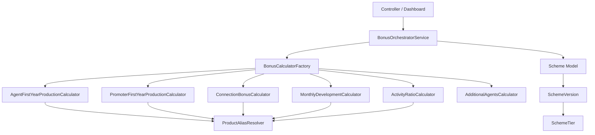

# 07 — Module: Bonus Calculation Engine

## Business Purpose
The core compensation calculation system. Evaluates whether a promoter or agent has met the conditions for any active bonus scheme and computes the payout amount. Uses the **Strategy Pattern** to isolate each bonus type's unique calculation logic while sharing common infrastructure through the **Orchestrator Pattern**.

## Architecture



---

## Key Files

| File | Role |
|------|------|
| `app/Services/BonusOrchestratorService.php` | Central orchestrator — loads schemes, resolves dependencies, dispatches to calculators |
| `app/Services/BonusCalculators/BonusCalculatorInterface.php` | Strategy interface that all calculators implement |
| `app/Services/BonusCalculators/BonusCalculatorFactory.php` | Maps `template_key` → calculator class |
| `app/Services/BonusCalculators/ProductAliasResolver.php` | Trait: resolves product aliases (e.g., "Vida" → METALIFE + PERFECTLIFE) |
| `app/Services/BonusCalculators/AgentFirstYearProductionCalculator.php` | Agent first-year PCA bonus |
| `app/Services/BonusCalculators/PromoterFirstYearProductionCalculator.php` | Promoter first-year PP + IRP bonus |
| `app/Services/BonusCalculators/ConnectionBonusCalculator.php` | Connection bonus (recruit PCA matrix) |
| `app/Services/BonusCalculators/MonthlyDevelopmentCalculator.php` | Monthly development bonus (agent PCA × tenure) |
| `app/Services/BonusCalculators/ActivityRatioCalculator.php` | Activity ratio (weighted policies) |
| `app/Services/BonusCalculators/AdditionalAgentsCalculator.php` | Additional agents bonus |
| `app/Services/BonusCompensationMatrix.php` | Builds each bonus' matrix, earned payment and next-level gap for the UI |
| `app/Services/BonusAdvanceService.php` | Monthly advances for first-year production bonuses (calc + overrides) |
| `app/Services/CommissionService.php` | Legacy commission calculator (partially deprecated) |

---

## BonusOrchestratorService — Orchestrator

### `calculateAll()` Flow
```
1. Load active bonus schemes filtered by target (agent/promoter)
2. Topological sort by dependencies (dependency_scheme_id)
3. For each scheme in order:
   a. Resolve effective period (monthly → month, trimestral → quarter, etc.)
   b. Check if dependency scheme was achieved (skip if not)
   c. Use BonusCalculatorFactory to get the right Strategy
   d. Execute calculator with effective period
   e. If dependency not achieved, force is_achieved = false but still show progress
4. Consolidate summary (total achieved, total amount)
```

### `calculateOne()` Flow
Same as above but for a single scheme by `template_key`. Useful for preview endpoints.

### `toFrontendFormat()`
Transforms the raw calculation result into a frontend-friendly format with:
- `name`, `unlocked` (boolean), `progress` (0-100), `target`, `conditions[]`
- `periodo_evaluado` / `mostrar_alerta_periodo` — real evaluation range and whether it exceeds the visual one
- `monthly_breakdown[]` / `monthly_total` — per-month amounts for monthly bonuses in multi-month ranges
- `matrix`, `earned`, `next_level` — see «Compensation Matrix» below

### Compensation Matrix (`BonusCompensationMatrix`)
`app/Services/BonusCompensationMatrix.php` normalizes, per bonus, everything the panel needs
for a quick read. The orchestrator attaches it to each result:

- `matrix.dependency` — prerequisite bonus name (`dependency_scheme_id`).
- `matrix.products[]` — required products and minimum counts (`requires_product`).
- `matrix.recruits` — quarterly recruit goals plus the current quarter and progress.
- `matrix.anticipos[]` — minimum production per monthly advance (`anticipos_config`).
- `matrix.equivalences[]` — PNA → policy equivalents (Activity Ratio only).
- `matrix.rules[]` — short reading notes (vida-only, IRP minimum, etc.).
- `matrix.tiers[]` — `label`, `requirement`, `percentage`, `payment`, `achieved`.
  `payment` is a ready-to-print string (e.g. `Efectivo 10% · Automático 16%`).
- `earned` — `percentage`, `fixed_amount`, `amount`, `note` (paid tier of the period).
- `next_level` — `label`, `requirement`, `percentage`, `gaps[]` and a ready `message`
  (e.g. «Faltan $86,400 en PCA para PCA ≥ $785,000 (36%)»). Gaps are computed from
  `details.metrics`, a per-calculator map keyed by tier condition names
  (`min_pp`, `min_pca`, `min_irp`, `min_policies`, `min_recruits`, `min_agents`).

`monthly_development` omits `next_level` because its matrix is evaluated per agent.

### Monthly Advances (`BonusAdvanceService`)
Only the first-year production bonuses may pay **monthly advances** (`requires_anticipos`):
`agent_first_year_production` and `first_year_production`.

- Each month is evaluated over the **cumulative** quarter up to that month.
- `advance(month) = cumulative_amount(month) − advances already paid`.
  So when the tier rises, the next advance includes the retroactive difference.
- Each month is broken down into `month_amount` (sales of the month at the
  current percentage) + `retroactive_amount` (rest of the calculated advance:
  percentage increase over the previous months' base plus any carried amounts)
  = `calculated`. `previous_percentage` / `percentage_delta` describe the tier
  jump; the breakdown is `null` on months with no retroactivity.
- `anticipos_config.month_N_min` gates the advance of month N by cumulative metric;
  if the minimum is not met that month the advance is 0 and carries to the next month.
- Amounts can be overridden from the panel and are stored in `bonus_advances`
  (`scheme_id`, `user_type`, `user_id`, `period_month`, `amount`, `created_by`).
  Overrides feed the following months' difference calculation.
- Endpoint: `POST /bonus-advances` → `BonusAdvanceController@store`
  (`SaveBonusAdvanceRequest`). Valid requests redirect back so Inertia refreshes props.
- Payload: `advances = { months: [{ month, label, cumulative_amount, previous_total,
  calculated, amount, is_override, minimum, below_minimum, unlocked, percentage,
  metric_label, metric, month_metric }], total, calculated_total, has_overrides,
  metric_label }`.
  `month_metric` es lo vendido en ese mes (`PCA` del agente o `PP` del equipo) y `metric`
  el acumulado hasta ese mes; el panel los muestra junto al porcentaje para comparar.
- La edición manual del monto está deshabilitada por ahora: `BonusAdvancesTable` recibe
  `editable` (por defecto `false`) y el lápiz queda inerte. Los montos guardados en
  `bonus_advances` siguen alimentando el cálculo.

### Period Expansion
The orchestrator "expands" the period based on scheme frequency:
- `mensual` → start to end of the month containing `periodEnd`
- `trimestral` → start to end of the quarter containing `periodEnd`
- `anual` → start to end of the year containing `periodEnd`
- `única` → uses the period as-is

This is separate from the "visual range" — what the user selected in the UI.

### Monthly View (`$monthlyView`)
`calculateAll(..., bool $monthlyView = false)` — used by the Directory info pages
(`agents.show` / `promoters.show`). When enabled:

- **Monthly bonuses** (`frequency = 'mensual'`, including `monthly_development`) are evaluated
  month by month across the visual range. The headline amount is the **sum** of the months and
  `monthly_breakdown` carries each month's `unlocked`, `amount` and `conditions`. The frontend
  renders it as a collapsible panel inside the bonus card.
- **Quarterly / annual bonuses** are evaluated over the **selected month only** when the visual
  range spans a single month; otherwise they keep their full period (quarter / year).
- `monthly_total = true` marks a bonus whose amount is the sum of several months.

The Dashboard keeps the legacy behaviour (no `$monthlyView`) so its projected-bonus totals are
unchanged.

---

## Dependency Resolution

Schemes can declare `dependency_scheme_id` (references another scheme's `template_key`). The orchestrator:
1. Builds a dependency graph.
2. Evaluates schemes in topological order (dependencies first).
3. If a prerequisite bonus was NOT achieved, the dependent bonus fails — but its progress bars still show so the user can see what they're missing.
4. A dependency bar is prepended to the `progress_breakdown` with `_isDependency: true`.

---

## Global Product Rule (bonus amounts)

`PRIMORDIAL` policies **never contribute money to a bonus**. Their premium is excluded
from PP, PCA, PNA, IRP and every amount-weighted index in all calculators.

- Implemented with `Policy::BONUS_AMOUNT_EXCLUDED_PRODUCTS` and the query scope
  `Policy::scopeCountableForBonusAmount()` (case-insensitive on `product_type`).
- Applied in: `AgentFirstYearProductionCalculator` (quarterly PCA and channel counts),
  `PromoterFirstYearProductionCalculator` (PP + IRP), `AdditionalAgentsCalculator` (team PP),
  `MonthlyDevelopmentCalculator` (agent PCA + collection efficiency) and
  `ConnectionBonusCalculator` (recruit PCA). `ActivityRatioCalculator` was already vida-only.
- They **still count** for `requires_product` requirements and for the policy counts that
  feed bonus rules (e.g. the 60% automatic-channel rule only counts eligible policies).
- Commissions are unaffected: `PRIMORDIAL` keeps its commission percentages.

---

## Calculator Details

### 1. AgentFirstYearProductionCalculator
**Template Keys:** `agent_first_year_production`, `Producción 1er Año Vida Trimestral (3 meses)`

**Rules:**
- Only applies to agents in their first year (`created_at + 1 year ≥ periodEnd`).
- Validates product requirements via `validateGlobalRules()` which supports two formats:
  - **New format** (since 2026-07-15): `[{product_type: "PRIMORDIAL", min_count: 3}]` — each product has its own minimum count. ALL must be met (AND logic).
  - **Legacy format**: `["PRIMORDIAL"]` + `min_product_count` column — maintained for backward compat.
- Uses `ProductAliasResolver` to resolve "Vida" → METALIFE + PERFECTLIFE when counting policies.
- Calculates the quarterly PCA per policy as `MAX(0, premium_amount − 1,350)` and splits it by `payment_method` (PRIMORDIAL premiums are excluded from the PCA):
  - **Cash PCA** (`Efectivo`) uses `agent_percentage` (**Bono Efectivo %**).
  - **Automatic PCA** (`Automático`, and any policy without a channel) uses `agent_automatic_percentage` (**Bono Automático %**).
- Evaluates tiers by `min_pca` descending. Each portion is evaluated on its own: `cash_pca × cash%` + `automatic_pca × automatic%`, where each percentage comes from the tier that portion reaches.
- **60% rule:** if at least 60% of the quarter's paid policies are automatic, the whole PCA is paid with the automatic percentage (tier chosen by total PCA).
- Bonus is paid ONLY if BOTH PCA and ALL product requirements are met.
- **The unlock requirement is the TOTAL PCA** (`cash_pca + automatic_pca`); the payment channel is
  not a requirement. `progress_breakdown` exposes a single «PCA Total del Trimestre ($)» bar plus
  the product bars and the policy count.
- Payout details are exposed in `details`: `cash_pca`, `automatic_pca`, `cash_amount`, `automatic_amount`, `automatic_ratio`, `payment_strategy` (`split` | `automatic`).
- `details.payment_info` carries the informational breakdown rendered before the advances block:
  `cash_pca`, `automatic_pca`, `cash_percentage`, `automatic_percentage`, `automatic_ratio`,
  `automatic_policy_count`, `total_policy_count`, `strategy` and `applied_percentage`
  (effective percentage over total PCA).

**Tier conditions:** `{"min_pca": 25000}`

---

### 2. PromoterFirstYearProductionCalculator
**Template Keys:** `first_year_production`, `Producción de 1er Año Trimestral`

**Rules:**
- Only applies to promoters.
- Calculates PP (Primary Production) = sum of premiums of all agents under the promoter (PRIMORDIAL premiums excluded).
- Calculates IRP (Index of Policy Retention) = (active policies / total policies) × 100 (PRIMORDIAL premiums excluded from both sides).
- Validates global rules: IRP ≥ `min_irp`, quarterly recruitment quota, product requirements.
- The recruitment quota comes from `Scheme::quarterlyRecruitsQuota($quarter)`, which accepts both
  `{"q1": 2}` and `{"1": 2}` key formats; the count is year-to-date up to the evaluated quarter.
- Missing required products fail early with an explicit reason
  (`Productos requeridos no cumplidos: Primordial (2/3).`).
- Evaluates tiers sorted by `promoter_percentage` descending.
- Payout: PP × `promoter_percentage` from the matching tier.

**Tier conditions:** `{"min_pp": 200000, "min_irp": 91, "max_irp": null}`

---

### 3. ConnectionBonusCalculator
**Template Keys:** `connection`, `Conexión`

**Rules:**
- Only applies to promoters.
- **Recruits accumulate through the year:** for any period, every agent created between January 1 of
  the period's year and the period end is considered (agents from previous years do not count).
- Each agent qualifies with its **PCA of the evaluated period** (not accumulated) when it reaches the
  lowest `min_pca` of the matrix.
- The number of **qualified** agents selects the recruit band (`min_recruits` / `max_recruits`:
  1-2, 3-4, 5+).
- **Individual payout:** each agent pays `own PCA × the percentage of the column its PCA reaches`
  inside that band (e.g. one agent at base PCA → 9%, another at high PCA → 11% in the same band).
  The `fixed_amount` of the applied tier is added per agent.
- `details.agent_breakdown` lists every recruited agent (`agent_name`, `agent_label`, `pca`,
  `percentage`, `base_amount`, `fixed_amount`, `amount`, `qualified`, `note`). The frontend renders it
  under the bonus card and monthly ranges aggregate the rows per agent.
- `earned.percentage` is `null` (there is no single percentage) and `next_level` is omitted.

**Tier conditions:** `{"min_recruits": 3, "max_recruits": 4, "min_pca": 30000}`

---

### 4. MonthlyDevelopmentCalculator
**Template Keys:** `monthly_development`, `Desarrollo Mensual`

**Rules:**
- Only applies to promoters.
- Validates global rules: collection efficiency ≥ `min_collection_efficiency`, quarterly recruitment quota
  (`Scheme::quarterlyRecruitsQuota($quarter)`, year-to-date count).
- For each agent under the promoter:
  - Calculates individual PCA in the period.
  - Calculates tenure (months since `created_at`).
- Tiers match on: PCA ≥ `min_pca` AND tenure in `[min_month, max_month]`.
- **Individual payout:** each agent pays `own PCA × the percentage of the tier it matches`
  (only one tier per agent); `fixed_amount` is added per agent.
- `details.agent_breakdown` lists every evaluated agent (`agent_label`, `pca`, `tenure_month`,
  `percentage`, `base_amount`, `fixed_amount`, `amount`, `qualified`, `note`). The frontend renders it
  under the bonus card and monthly ranges aggregate the rows per agent.
- `earned.percentage` is `null` (no single percentage) and `next_level` is omitted.

**Tier conditions:** `{"min_pca": 15000, "min_month": 0, "max_month": 12}`

---

### 5. ActivityRatioCalculator
**Template Keys:** `activity_ratio`, `Activity Ratio`

**Rules:**
- Only applies to agents.
- **Requires dependency:** `dependency_scheme_id` (typically `agent_first_year_production`). Evaluated dynamically by the calculator itself.
- Only **vida** policies (`Vida`, `METALIFE`, `PERFECTLIFE` via `ProductAliasResolver`) are weighted; `PRIMORDIAL` policies are excluded from the weighted total and from the «Pólizas de vida totales» row.
- Uses `pna_equivalences` to weight each policy by its PNA bracket.
- Calculates weighted total, divides by 3 for monthly average (trimestral).
- Tiers match on `[min_policies, max_policies]`.
- Payout: PCA × `agent_percentage`. The PCA base also excludes `PRIMORDIAL`, so the whole bonus works on vida policies only.

**Tier conditions:** `{"classification": "Plata", "min_policies": 2.0, "max_policies": 2.99}`

**PNA Equivalences Example:**
| PNA Range | Weight |
|-----------|--------|
| $16,000 – $20,999 | 0.5 |
| $21,000 – $59,999 | 1.0 |
| $60,000 – $119,999 | 1.5 |
| ≥ $120,000 | 2.0 |
| < $16,000 | ignored |

---

### 6. AdditionalAgentsCalculator
**Template Keys:** `additional_agents`, `Adicional por Agentes con Compensación`

**Rules:**
- Only applies to promoters.
- **Requires dependency:** `dependency_scheme_id` (verified by orchestrator).
- **Qualified agents = agents that won the Activity Ratio bonus** in the evaluated period.
  Each agent counts once per quarter; it must win Activity Ratio again in the next quarter.
  Agents with no Activity Ratio scheme achieved (or without production) do not count.
- Calculates total PP across all active agents.
- Tiers match on `[min_agents, max_agents]`; tiers are cumulative, so a count above the
  highest configured tier keeps that tier (e.g. 6 agents → «5+»).
- Payout: PP × `promoter_percentage`.
- Requires an active `activity_ratio` scheme; otherwise the bonus cannot be evaluated.

**Tier conditions:** `{"min_agents": 3, "max_agents": 5}`

> Nota: como los tramos son acumulativos, un conteo por encima del `max_agents` del tramo más alto conserva ese tramo.

---

## ProductAliasResolver Trait

**Product Alias:** "Vida" is an alias that groups two real products:
```
"Vida" → ["METALIFE", "PERFECTLIFE"]
```

When a scheme requires "Vida" (e.g., `requires_product: ["Vida"]`), the calculators count policies of both METALIFE and PERFECTLIFE toward the requirement. "PRIMORDIAL" is not aliased — it stands alone.

Used by: `AgentFirstYearProductionCalculator`, `PromoterFirstYearProductionCalculator`.

**Agent labels in breakdowns:** `Agent::shortName($promoterName)` strips the promoter prefix from the
agent name (e.g. «PRUEBA B - Anticipo mensual · Agente 1» → «Agente 1») so per-agent breakdowns show the
agent identity instead of repeating the promoter name.

---

## CommissionService (Legacy)

`app/Services/CommissionService.php` is an older commission calculator that:
- Uses a `code` field on schemes (no longer in the schema).
- References `percentage` and `fixed_amount` on tiers differently.
- Has a simpler `evaluateConditions` method.

**Status:** Partially deprecated. New code uses `PolicyController::getProductCommissionMap()` for commission lookups and `BonusOrchestratorService` for bonus calculations. This service may be safe to remove after verifying no references remain.

---

## BonusCalculatorFactory Map

```
connection                          → ConnectionBonusCalculator
Conexión                            → ConnectionBonusCalculator
first_year_production               → PromoterFirstYearProductionCalculator
Producción de 1er Año Trimestral    → PromoterFirstYearProductionCalculator
monthly_development                 → MonthlyDevelopmentCalculator
Desarrollo Mensual                  → MonthlyDevelopmentCalculator
activity_ratio                      → ActivityRatioCalculator
Activity Ratio                      → ActivityRatioCalculator
additional_agents                   → AdditionalAgentsCalculator
Adicional por Agentes con Compensación → AdditionalAgentsCalculator
agent_first_year_production         → AgentFirstYearProductionCalculator
Producción 1er Año Vida Trimestral (3 meses) → AgentFirstYearProductionCalculator
```

Note: Both the English `template_key` and the Spanish display name are mapped. This accommodates schemes created before `template_key` was added.

---

## Result Structure (from any calculator)

```php
[
    'is_achieved'        => bool,
    'amount'             => float,
    'tier_index'         => int|null,
    'tier_data'          => array|null,
    'progress'           => [
        'metric_label'   => string,
        'current_value'  => float,
        'required_value' => float,
    ],
    'progress_breakdown' => [
        ['label' => string, 'current' => float|int, 'target' => float|int, 'met' => bool],
        // ...
    ],
    'details'            => array,
    // ... enriched with scheme metadata by orchestrator
]
```

---

## Dependencies
- **Scheme Management** — Reads scheme configurations
- **Policy Management** — Reads policies for metric calculations
- **Promoter/Agent Management** — Reads sales force structure

## Known Limitations / Tech Debt
1. **Duplicate dependency verification:** `ActivityRatioCalculator` re-verifies its dependency by instantiating `AgentFirstYearProductionCalculator` directly, bypassing the orchestrator. This is fragile — if the orchestrator changes, this code won't know.
2. **Spanish + English template keys:** The factory maps both languages. If a scheme is created with a slightly different name, it won't be recognized. Moving to template_key-only resolution would be cleaner.
3. **No unit tests visible:** The bonus calculators contain complex business logic but no test files were found in the workspace.
4. **`calculateAmount` method varies:** Not all calculators use the same method signature. Some multiply by percentage, some use fixed amounts. The method is defined differently per calculator.
5. **Error swallowing:** Dashboard and detail views wrap orchestrator calls in `try/catch` with `continue`. Calculation errors are silently ignored.
6. **CommissionService dead code:** May contain unused methods. Should be audited before removal.

---

## Full Source Code

### Source: `app/Services/BonusCalculators/BonusCalculatorInterface.php`

```php
<?php

namespace App\Services\BonusCalculators;

use App\Models\Agent;
use App\Models\Promoter;
use App\Models\Scheme;
use Carbon\Carbon;

interface BonusCalculatorInterface
{
    public function calculate(
        Agent|Promoter $user,
        Scheme $scheme,
        Carbon $periodStart,
        Carbon $periodEnd
    ): array;
}
```

### Source: `app/Services/BonusCalculators/BonusCalculatorFactory.php`

```php
<?php

namespace App\Services\BonusCalculators;

use InvalidArgumentException;

class BonusCalculatorFactory
{
    protected array $calculatorMap = [
        'connection'                         => ConnectionBonusCalculator::class,
        'Conexión'                           => ConnectionBonusCalculator::class,
        'first_year_production'              => PromoterFirstYearProductionCalculator::class,
        'Producción de 1er Año Trimestral'   => PromoterFirstYearProductionCalculator::class,
        'monthly_development'                => MonthlyDevelopmentCalculator::class,
        'Desarrollo Mensual'                 => MonthlyDevelopmentCalculator::class,
        'activity_ratio'                     => ActivityRatioCalculator::class,
        'Activity Ratio'                     => ActivityRatioCalculator::class,
        'additional_agents'                  => AdditionalAgentsCalculator::class,
        'Adicional por Agentes con Compensación' => AdditionalAgentsCalculator::class,
        'agent_first_year_production'        => AgentFirstYearProductionCalculator::class,
        'Producción 1er Año Vida Trimestral (3 meses)' => AgentFirstYearProductionCalculator::class,
    ];

    public function make(string $schemeName): BonusCalculatorInterface
    {
        if (!isset($this->calculatorMap[$schemeName])) {
            throw new InvalidArgumentException(
                "No existe una calculadora de bono para el esquema: «{$schemeName}». " .
                'Esquemas disponibles: ' . implode(', ', array_keys($this->calculatorMap))
            );
        }
        $class = $this->calculatorMap[$schemeName];
        return app($class);
    }

    public function register(string $schemeName, string $calculatorClass): void
    {
        $this->calculatorMap[$schemeName] = $calculatorClass;
    }

    public function supportedSchemes(): array
    {
        return array_keys($this->calculatorMap);
    }
}
```

### Source: `app/Services/BonusCalculators/ProductAliasResolver.php`

```php
<?php

namespace App\Services\BonusCalculators;

trait ProductAliasResolver
{
    protected array $productAliases = [
        'Vida' => ['METALIFE', 'PERFECTLIFE'],
    ];

    protected function resolveProductAlias(string $productType): array
    {
        return $this->productAliases[$productType] ?? [$productType];
    }

    protected function productMatchesAlias(string $actualProductType, string $requiredAlias): bool
    {
        $resolved = $this->resolveProductAlias($requiredAlias);
        return in_array($actualProductType, $resolved, true);
    }
}
```

> **Note:** The full source for `BonusOrchestratorService.php` (~500 lines), all 6 calculator files, and `CommissionService.php` are too large to include inline. See the actual repository files at:
> - `app/Services/BonusOrchestratorService.php`
> - `app/Services/BonusCalculators/AgentFirstYearProductionCalculator.php`
> - `app/Services/BonusCalculators/PromoterFirstYearProductionCalculator.php`
> - `app/Services/BonusCalculators/ConnectionBonusCalculator.php`
> - `app/Services/BonusCalculators/MonthlyDevelopmentCalculator.php`
> - `app/Services/BonusCalculators/ActivityRatioCalculator.php`
> - `app/Services/BonusCalculators/AdditionalAgentsCalculator.php`
>
> The prose sections above document the exact business rules and formulas for each calculator. The source code in the repository is the ground truth for implementation details.

## Key Formula Summary (from source)

### AgentFirstYearProductionCalculator
- PCA = sum of `premium_amount` for policies in first year where `status='Pagada'`
- PCA is NOT computed as `max(0, premium - 1350)` — it's raw `premium_amount` sum
- Primordial requirement queries ALL policies (not period-limited): `$agent->policies()->whereIn('product_type', $resolvedTypes)->where('status', 'Pagada')->count()`
- Payout: `PCA × (agent_percentage / 100)` — no fixed_amount fallback used

### PromoterFirstYearProductionCalculator
- PP = sum of `premium_amount` across all agents
- IRP = (Pagada premiums / total non-NoTomada premiums) × 100
- Recruits counted YTD: `whereBetween('created_at', [$yearStart, $quarterEnd])`
- Payout: `PP × (promoter_percentage / 100)`

### ConnectionBonusCalculator
- Recruits accumulate through the year: agents created between Jan 1 and the period end
- Individual PCA = `Σ max(0, premium_amount − 1,350)` per recruit (PRIMORDIAL excluded)
- The number of qualified agents selects the recruit band; each agent pays with the percentage of
  the column its own PCA reaches (plus `fixed_amount` per agent)
- `details.agent_breakdown` exposes the per-agent rows
